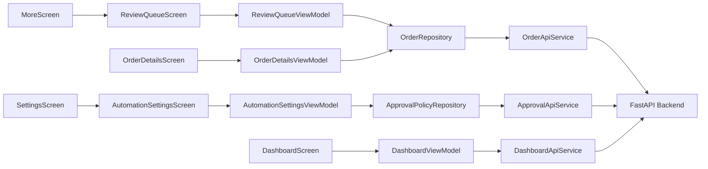

# Requirements

### Overview & Goals

Implement the Android Admin Portal side of the NearAI Order Automation Engine. The goal is to automate approval of ordinary COD orders (≤ JOD 200) and require administrator intervention for higher-value orders. The Admin Portal must provide:

1. A dedicated **Needs Review** queue for manual approval decisions.
2. **Contextual Order Details** actions that adapt to approval and fulfillment state.
3. An **Order Automation Settings** screen for configuring thresholds.
4. Enhanced **Dashboard** and **Orders List** with approval visibility.

### Business Rules (Initial Jordan Electronics Policy)

| Final Order Total (JOD) | Decision |
|---|---|
| 0.00–200.00 | Automatic approval |
| 200.01–500.00 | Standard manual review |
| Above 500.00 | Mandatory manual approval |

- Thresholds must be **configurable through the backend** — never hardcoded in Android.
- Backend calculates the authoritative final order amount.
- Decimal/fixed-precision monetary calculations.
- Approval state is **separate** from order_status, fulfillment_status, and payment_status.

### User Stories

- As an admin, I want to see a dedicated Needs Review queue so I can focus on orders that require my attention.
- As an admin, I want mandatory approval orders to appear first and be visually distinct so I prioritize high-value orders.
- As an admin, I want contextual actions on Order Details so I don't see confusing or irrelevant buttons.
- As an admin, I want to configure approval thresholds so the business can adjust policy without a code deployment.
- As an admin, I want the Dashboard to show orders awaiting review so I have immediate visibility.

### Scope

**In Scope (Android Admin Portal):**
- New approval domain models, DTOs, and API contracts.
- Review Queue screen (Phase F).
- Redesigned Order Details with contextual actions (Phase G).
- Order Automation Settings screen (Phase H).
- Dashboard and Orders List enhancements (Phase I).
- Comprehensive tests (Phase J).

**Out of Scope (Backend — separate repository):**
- Backend approval policy engine (Phase B).
- Order approval decision model in DB (Phase C).
- Checkout automation integration (Phase D).
- Manual review backend APIs (Phase E).

### Functional Requirements

1. **Review Queue** — Paginated list of orders awaiting approval, separated by standard vs mandatory. Supports approve/reject with confirmation.
2. **Order Details** — Shows approval status, automation decision info, financial summary, payment details, and one contextual primary action.
3. **Automation Settings** — Display and edit approval thresholds with validation, confirmation, and server-confirmed save.
4. **Dashboard** — Surface orders awaiting review, mandatory approvals, and auto-approved counts.
5. **Orders List** — Filter by approval status; show approval badges on order cards.

### Non-Functional Requirements

- All UI text in Android string resources.
- No hardcoded thresholds — all from backend.
- No fabricated metrics — all from actual backend responses.
- Lifecycle-aware StateFlow collection.
- Existing `Result`/`AppError` error handling.
- `TokenRefreshManager` for all authenticated calls.
- `ApiErrorParser` for HTTP error handling.
- Hilt dependency injection.
- Material 3 with existing design system (Navy `#1E1B4B`, Indigo `#6366F1`).

# Technical Design

### Current Implementation

The orders feature module (`feature/orders/`) follows the established Clean Architecture pattern:

- **Domain:** `OrderRepository` interface, `OrderSummary`, `OrderDetails`, `OrderStatus`, `FulfillmentStatus`, `PaymentInfo`.
- **Data:** `OrderApiService` (Retrofit), `PaymentApiService`, `OrderRepositoryImpl`, `OrderMapper`, `OrderModule` (Hilt).
- **Presentation:** `OrdersListViewModel`/`OrdersListScreen`, `OrderDetailsViewModel`/`OrderDetailsScreen`, `OrderComponents`.

Current order statuses: `PENDING`, `COMPLETED`, `CANCELLED`, `REJECTED`.
Current fulfillment statuses: `UNFULFILLED`, `AWAITING_CONFIRMATION`, `CONFIRMED`, `PROCESSING`, `OUT_FOR_DELIVERY`, `DELIVERED`.

The Order Details screen currently shows four equal-priority buttons (Collect Cash, Confirm, Reject, Cancel) which the task requires replacing with contextual actions.

Navigation uses type-safe `@Serializable` routes in `AppNavHost.kt` with `hiltViewModel()` injection.

### Key Decisions

1. **Approval as a separate dimension** — Introduce `ApprovalStatus` enum distinct from `OrderStatus` and `FulfillmentStatus`. This avoids coupling approval with fulfillment or payment state.

2. **Extend existing domain models** — Add approval fields to `OrderSummary` and `OrderDetails` rather than creating parallel models. This keeps the presentation layer simple.

3. **Dedicated ReviewQueue feature** — Create a new `ReviewQueueViewModel` and `ReviewQueueScreen` within the existing `feature/orders/presentation/` package rather than a separate feature module, since it shares the same repository and domain models.

4. **Automation Settings in Settings area** — Integrate the automation settings as a sub-screen of the existing Settings navigation (accessible from `MoreScreen → Settings → Order Automation`) rather than creating a new top-level navigation entry.

5. **Backend-driven thresholds** — The Android app fetches approval policy from the backend via a dedicated API. No local caching as source of truth.

6. **Approval API endpoints** — New endpoints will be added to `OrderApiService` for review queue operations and a separate `ApprovalApiService` for policy configuration.

### Proposed Changes

#### 1. Domain Layer Changes

**New enums in `domain/OrderStatus.kt`:**
```kotlin
enum class ApprovalStatus {
    AUTO_APPROVED,
    AWAITING_STANDARD_REVIEW,
    AWAITING_MANDATORY_APPROVAL,
    MANUALLY_APPROVED,
    REJECTED
}
```

**New domain models in `domain/OrderRepository.kt`:**
```kotlin
data class ApprovalDecisionSnapshot(
    val decision: ApprovalStatus,
    val evaluatedAmount: Double,
    val currency: String,
    val decisionReason: String?,
    val policyVersion: Int?,
    val evaluatedAt: String,
    val approvedBy: String?,
    val approvedAt: String?
)

data class ApprovalPolicyConfig(
    val autoApprovalLimit: Double,
    val mandatoryReviewThreshold: Double,
    val currency: String,
    val enabled: Boolean,
    val version: Int?,
    val updatedAt: String?,
    val updatedBy: String?
)

data class ReviewQueueOrder(
    val id: String,
    val createdAt: String,
    val status: OrderStatus,
    val fulfillmentStatus: FulfillmentStatus,
    val approvalStatus: ApprovalStatus,
    val totalAmount: Double,
    val currency: String,
    val items: List<OrderItem>,
    val deliveryRecipientName: String?,
    val deliveryPhone: String?,
    val approvalDecision: ApprovalDecisionSnapshot?,
    val isMandatory: Boolean
)
```

**Extended existing models:**
- `OrderSummary` — add `approvalStatus: ApprovalStatus?`, `approvalDecision: ApprovalDecisionSnapshot?`
- `OrderDetails` — add same approval fields

**New repository methods:**
```kotlin
suspend fun listReviewQueue(
    page: Int = 1,
    size: Int = 20,
    mandatoryOnly: Boolean = false
): Result<PaginatedReviewQueue>

suspend fun approveOrder(orderId: String): Result<Unit>

suspend fun rejectForApproval(orderId: String, reason: String): Result<Unit>

suspend fun getApprovalPolicy(): Result<ApprovalPolicyConfig>

suspend fun updateApprovalPolicy(
    autoApprovalLimit: Double,
    mandatoryReviewThreshold: Double,
    enabled: Boolean
): Result<ApprovalPolicyConfig>
```

#### 2. Data Layer Changes

**New DTOs in `data/OrderApiService.kt`:**
- `ApprovalDecisionDto` — maps to `ApprovalDecisionSnapshot`
- `ReviewQueueResponseDto` — paginated review queue response
- `ReviewQueueOrderDto` — individual review queue entry

**New endpoints in `data/OrderApiService.kt`:**
```kotlin
@GET("api/v1/orders/admin/review-queue")
suspend fun listReviewQueue(...)

@POST("api/v1/orders/admin/{order_id}/approve")
suspend fun approveOrder(@Path("order_id") orderId: String)

@POST("api/v1/orders/admin/{order_id}/reject-for-approval")
suspend fun rejectForApproval(@Path("order_id") orderId: String, @Body request: RejectApprovalRequest)
```

**New `data/ApprovalApiService.kt`:**
```kotlin
@GET("api/v1/admin/approval-policy")
suspend fun getApprovalPolicy(): ApprovalPolicyDto

@PUT("api/v1/admin/approval-policy")
suspend fun updateApprovalPolicy(@Body request: UpdatePolicyRequest): ApprovalPolicyDto
```

**Mapper extensions in `data/OrderMapper.kt`:**
- `mapApprovalDecision(dto: ApprovalDecisionDto): ApprovalDecisionSnapshot`
- `mapReviewQueueOrder(dto: ReviewQueueOrderDto): ReviewQueueOrder`
- `mapApprovalPolicy(dto: ApprovalPolicyDto): ApprovalPolicyConfig`

**RepositoryImpl extensions in `data/OrderRepositoryImpl.kt`:**
- Implement new repository methods with `tokenRefreshManager.refreshAndRetry` and `ApiErrorParser`.

**Hilt bindings in `data/OrderModule.kt`:**
- Provide `ApprovalApiService` via Retrofit.

#### 3. Presentation Layer Changes

**Review Queue (`presentation/ReviewQueueViewModel.kt`, `presentation/ReviewQueueScreen.kt`):**
- `ReviewQueueUiState` — isLoading, orders, error, filter (all/standard/mandatory), pagination.
- `loadReviewQueue()`, `approveOrder()`, `rejectOrder()`, `onFilterChanged()`.
- Screen with pull-to-refresh, filter chips, paginated list, empty/loading/error states.
- `ReviewQueueOrderCard` — order number, customer, amount, time, approval reason, mandatory distinction.

**Order Details Redesign (`presentation/OrderDetailsScreen.kt`, `presentation/OrderDetailsViewModel.kt`):**
- Extend `OrderDetailsUiState` with approval fields.
- Add `ApprovalInfoCard` composable.
- Replace `OrderActionButtons` with `ContextualActionCard`:
  - Awaiting review → "Review and Approve" + "Reject" (guarded).
  - Approved → "Start Preparing" (if fulfillment supports).
  - Preparing → "Mark Ready for Delivery".
  - Ready → "Dispatch".
  - Out for delivery → "Confirm Delivery".
  - Delivered, COD outstanding → "Record Cash Collection".
  - Cash collected → confirmed payment info.
- Add `approveForReview()` and `rejectForApproval()` to ViewModel.

**Automation Settings (`presentation/AutomationSettingsViewModel.kt`, `presentation/AutomationSettingsScreen.kt`):**
- `AutomationSettingsUiState` — isLoading, policy, error, isSaving, validationError.
- `loadPolicy()`, `savePolicy()`, `onAutoApprovalLimitChanged()`, `onMandatoryThresholdChanged()`.
- Screen with current limits display, input fields, validation, enable/disable, confirmation dialog.

**Dashboard Enhancements (`presentation/DashboardScreen.kt`):**
- Add approval metrics to `DashboardUiState`: `ordersAwaitingReview`, `mandatoryApprovals`, `autoApprovedToday`.
- New `MetricCard` entries in dashboard.

**Orders List Enhancements (`presentation/OrdersListScreen.kt`, `presentation/OrdersListViewModel.kt`):**
- Add `filterApprovalStatus` to `OrdersListUiState`.
- Approval status filter chips.
- Approval badge on `OrderSummaryCard`.

#### 4. Navigation Changes

**New routes in `navigation/AppDestination.kt`:**
```kotlin
@Serializable
object ReviewQueueRoute

@Serializable
object AutomationSettingsRoute
```

**New destinations in `navigation/AppNavHost.kt`:**
- `ReviewQueueRoute` → `ReviewQueueScreen`
- `AutomationSettingsRoute` → `AutomationSettingsScreen`

**Menu item in `MoreScreen`:**
- "Needs Review" → `ReviewQueueRoute`

**Menu item in `SettingsScreen`:**
- "Order Automation" → `AutomationSettingsRoute`

#### 5. String Resources

New file `strings_automation.xml` for automation-specific strings:
- Approval status labels
- Review queue labels
- Automation settings labels
- Contextual action labels
- Validation messages

Extend `strings_orders.xml` with:
- Approval badge labels
- Approval filter labels
- Dashboard approval metrics

### File Structure

```
feature/orders/
├── data/
│   ├── ApprovalApiService.kt          (NEW)
│   ├── OrderApiService.kt             (MODIFIED — new endpoints, DTOs)
│   ├── OrderMapper.kt                 (MODIFIED — approval mapping)
│   ├── OrderModule.kt                 (MODIFIED — ApprovalApiService binding)
│   └── OrderRepositoryImpl.kt         (MODIFIED — new methods)
├── domain/
│   ├── OrderRepository.kt             (MODIFIED — new models, methods)
│   └── OrderStatus.kt                 (MODIFIED — ApprovalStatus enum)
└── presentation/
    ├── AutomationSettingsScreen.kt    (NEW)
    ├── AutomationSettingsViewModel.kt (NEW)
    ├── OrderComponents.kt             (MODIFIED — approval badge)
    ├── OrderDetailsScreen.kt          (MODIFIED — contextual actions)
    ├── OrderDetailsViewModel.kt       (MODIFIED — approval methods)
    ├── OrdersListScreen.kt            (MODIFIED — approval filter)
    ├── OrdersListViewModel.kt         (MODIFIED — approval filter)
    ├── ReviewQueueScreen.kt           (NEW)
    └── ReviewQueueViewModel.kt        (NEW)

navigation/
├── AppDestination.kt                  (MODIFIED — new routes)
└── AppNavHost.kt                      (MODIFIED — new destinations)

feature/more/presentation/
└── MoreScreen.kt                      (MODIFIED — Needs Review menu)

feature/settings/presentation/
└── SettingsScreen.kt                  (MODIFIED — Order Automation menu)

feature/dashboard/presentation/
└── DashboardScreen.kt                 (MODIFIED — approval metrics)

res/values/
├── strings_automation.xml             (NEW)
└── strings_orders.xml                 (MODIFIED — approval labels)
```

### Architecture Diagram



### Risks

1. **Backend API not yet implemented** — The Android plan assumes specific API contracts. If the backend endpoints differ, the DTOs and service interfaces will need adjustment. Mitigation: coordinate API contracts with backend team before implementation.

2. **Approval state backward compatibility** — Existing orders without approval data must render gracefully. Mitigation: make approval fields nullable in domain models and provide default UI behavior.

3. **Concurrent approval attempts** — Two admins approving the same order simultaneously. Mitigation: rely on backend idempotency and handle conflict errors in the UI.

4. **Settings screen hardcoding** — The current `SettingsScreen` has a hardcoded title "Settings". This will be fixed as part of the automation settings integration.

# Testing

### Validation Approach

Follow the project's mandatory testing conventions:
- **ViewModel tests** — `kotlinx-coroutines-test` + `Turbine` for StateFlow verification.
- **Repository tests** — `mockk` for API service mocking, verify `TokenRefreshManager` integration.
- **Mapper tests** — DTO-to-domain transformations including nullable approval fields.
- **DTO serialization tests** — Kotlinx Serialization with real API payload shapes.

### Key Scenarios

#### ReviewQueueViewModel
- Load review queue returns orders with approval status.
- Filter by mandatory-only shows only mandatory approvals.
- Approve order succeeds → order removed from queue, state refreshed.
- Approve order fails → error state preserved, order remains.
- Reject order with reason succeeds → order removed, state refreshed.
- Reject without reason → validation error.
- Pagination loads next page correctly.
- Pull-to-refresh reloads from page 1.

#### OrderDetailsViewModel
- Order with `AWAITING_STANDARD_REVIEW` shows approve/reject actions.
- Order with `AWAITING_MANDATORY_APPROVAL` shows approve/reject actions.
- Order with `AUTO_APPROVED` shows fulfillment actions only.
- Order with `MANUALLY_APPROVED` shows fulfillment actions only.
- Order with `REJECTED` shows no actions.
- Approve from review context succeeds → order state refreshed.
- Reject from review context succeeds → order state refreshed.
- Stale reservation error handled gracefully.

#### AutomationSettingsViewModel
- Load policy returns current thresholds.
- Save with valid thresholds succeeds → policy refreshed from backend.
- Save with auto > mandatory → validation error, not sent.
- Save with negative threshold → validation error.
- Save with disabled → sent correctly.
- Concurrent save conflict handled.

#### OrdersListViewModel
- Filter by approval status works correctly.
- Approval badge renders on order cards.
- Clear filters removes approval filter.

#### Mapper Tests
- `OrderMapper.mapApprovalDecision` handles nullable fields.
- `OrderMapper.mapReviewQueueOrder` maps all fields including approval snapshot.
- `OrderMapper.mapApprovalPolicy` maps policy config correctly.
- `ApprovalStatus.fromString` handles unknown values gracefully.

### Edge Cases

- Order without approval data (pre-automation orders) → render without approval card, use existing action logic.
- Approval policy not configured → show default state with message.
- Network error during approval → show error, keep order in queue.
- 401 during review queue load → `TokenRefreshManager` handles refresh automatically.
- Empty review queue → show empty state with clear message.
- Policy save returns different values (server rounding) → UI reflects server response.

### Test Files

```
app/src/test/java/com/nearai/admin/feature/orders/
├── data/
│   ├── OrderMapperTest.kt              (MODIFIED — approval mapping tests)
│   ├── OrderRepositoryImplTest.kt      (NEW — approval endpoint tests)
│   └── ApprovalDtoSerializationTest.kt (NEW — DTO serialization)
└── presentation/
    ├── ReviewQueueViewModelTest.kt     (NEW)
    ├── OrderDetailsViewModelTest.kt    (MODIFIED — approval scenarios)
    ├── OrdersListViewModelTest.kt      (MODIFIED — approval filter)
    └── AutomationSettingsViewModelTest.kt (NEW)
```

# Delivery Steps

### ✓ Step 1: Approval domain models and API contracts
Introduce approval-specific domain types, DTOs, and API endpoints into the existing orders feature module.

- Add `ApprovalStatus` and `ApprovalDecision` enums to `domain/OrderStatus.kt`.
- Add `ApprovalDecisionSnapshot`, `ApprovalPolicyConfig`, and `ReviewQueueOrder` domain models to `domain/OrderRepository.kt`.
- Extend `OrderSummary` and `OrderDetails` with approval fields (approvalStatus, approvalDecision, evaluatedAmount, etc.).
- Add new Retrofit endpoints to `OrderApiService`: list review queue, approve order, reject for approval, approval policy CRUD.
- Create `ApprovalApiService` for dedicated approval policy endpoints.
- Add corresponding DTOs (`ApprovalDecisionDto`, `ApprovalPolicyDto`, `ReviewQueueResponseDto`).
- Extend `OrderMapper` with approval field mapping.
- Extend `OrderRepository` interface with: `listReviewQueue()`, `approveOrder()`, `rejectForApproval()`, `getApprovalPolicy()`, `updateApprovalPolicy()`.
- Implement new repository methods in `OrderRepositoryImpl` with `tokenRefreshManager.refreshAndRetry` and `ApiErrorParser`.
- Update `OrderModule` Hilt bindings for new services.
- Add string resources for approval labels in `strings_orders.xml`.

### ✓ Step 2: Review Queue screen and ViewModel
Build a dedicated Needs Review screen with a paginated list of orders awaiting approval.

- Create `ReviewQueueViewModel` with `StateFlow<ReviewQueueUiState>` for loading, filtering (standard vs mandatory), pagination, approve/reject actions.
- Create `ReviewQueueScreen.kt` with `collectAsStateWithLifecycle()`, pull-to-refresh, empty/loading/error states.
- Add `ReviewQueueOrderCard` composable showing: order number, customer, amount, creation time, approval reason, mandatory vs standard distinction.
- Mandatory approvals sorted first and visually distinguished (RoseError accent).
- Tap navigates to Order Details.
- Approve (primary) and Reject (secondary, guarded with confirmation dialog) actions.
- Add `ReviewQueueRoute` to `AppDestination.kt` and navigation in `AppNavHost.kt`.
- Add menu item in `MoreScreen` for Needs Review.
- Add string resources in `strings_orders.xml`.
- Add ViewModel tests (load queue, approve, reject, error handling) using `mockk`, `Turbine`, `runTest`.

### ✓ Step 3: Redesign Order Details with contextual actions
Replace the four equal-priority buttons with contextual primary actions based on approval and fulfillment state.

- Extend `OrderDetailsUiState` with approval fields: `approvalStatus`, `approvalDecision`, `evaluatedAmount`, `decisionReason`, `policyVersion`.
- Add `ApprovalInfoCard` composable showing automation decision info.
- Replace `OrderActionButtons` with `ContextualActionCard` that renders one primary action based on state:
  - Awaiting review → "Review and Approve" (primary) + "Reject" (secondary, guarded).
  - Auto/manual approved → "Start Preparing" (when fulfillment supports it).
  - Preparing → "Mark Ready for Delivery".
  - Ready for delivery → "Dispatch".
  - Out for delivery → "Confirm Delivery".
  - Delivered, COD outstanding → "Record Cash Collection".
  - Cash collected → show confirmed payment info, no action.
- Remove Collect Cash from equal-priority button grid.
- Move Cancel to overflow/contextual action only where permitted.
- Update `OrderDetailsViewModel` with `approveForReview()` and `rejectForApproval()` methods.
- Update `OrderDetailsScreen` to render approval card and new action layout.
- Add string resources for new action labels and approval info.
- Update ViewModel tests for new approval flows.

###   Step 4: 4. Order Automation Settings screen
Add an authorized Order Automation Settings experience integrated into the existing Settings area.

- Create `AutomationSettingsViewModel` with `StateFlow<AutomationSettingsUiState>` for loading, editing, and saving policy config.
- Create `AutomationSettingsScreen.kt` with:
  - Current limits display (auto-approval ≤ JOD 200, standard review JOD 200.01–500, mandatory > JOD 500).
  - Two-decimal monetary input fields for `auto_approval_limit` and `mandatory_review_threshold`.
  - Input validation (non-negative, auto ≤ mandatory).
  - Enable/disable toggle.
  - Confirmation dialog before saving.
  - Server-confirmed result with refresh from backend.
- Add `AutomationSettingsRoute` to `AppDestination.kt` and navigation in `AppNavHost.kt`.
- Add menu item in `SettingsScreen` for Order Automation.
- Add `ApprovalPolicyApiService` endpoints (GET/PUT policy config).
- Add string resources in new `strings_automation.xml`.
- Add ViewModel tests for validation, save, refresh, error handling.

###   Step 5: 5. Dashboard and Orders List enhancements
Enhance the existing dashboard and orders list to surface approval-related visibility.

- Extend `DashboardUiState` with approval metrics: `ordersAwaitingReview`, `mandatoryApprovals`, `autoApprovedToday`.
- Update `DashboardApiService` DTOs to include approval metrics from backend.
- Add new `MetricCard` entries in `DashboardScreen` for approval visibility.
- Extend `OrdersListUiState` with `filterApprovalStatus` (optional filter chip).
- Add approval status filter chips in `OrdersListScreen`.
- Update `OrderSummaryCard` to show approval badge (auto-approved, manual review, mandatory approval).
- Update `OrdersListViewModel` with approval filter support.
- Ensure no N+1 API calls for payment status — extend backend list response efficiently.
- Add string resources for approval filter labels and dashboard metrics.
- Update existing tests for new filter and dashboard state.

###   Step 6: 6. Tests and quality gates
Add comprehensive tests and run quality gates for all new and modified code.

- **Repository tests:** `OrderRepositoryImpl` tests for new approval endpoints (listReviewQueue, approveOrder, rejectForApproval, getApprovalPolicy, updateApprovalPolicy) with `mockk`.
- **Mapper tests:** `OrderMapper` tests for approval field mapping (DTO-to-domain, nullable approval fields, enum parsing).
- **ViewModel tests:**
  - `ReviewQueueViewModel`: load queue, standard vs mandatory, approve success/failure, reject success/failure, pagination, refresh.
  - `OrderDetailsViewModel`: approval state transitions, contextual action callbacks, stale reservation handling.
  - `AutomationSettingsViewModel`: threshold validation, save success/failure, enable/disable, refresh.
  - `OrdersListViewModel`: approval filter, approval badge rendering.
- **DTO serialization tests:** Verify Kotlinx Serialization handles approval DTOs correctly (nullable fields, defaults).
- Use `Turbine` for StateFlow emissions, `runTest` for coroutine scopes, `mockk` for dependencies.
- Run Kotlin compilation, lint, and debug assembly.
- Report actual test results (passed/failed/blocked).