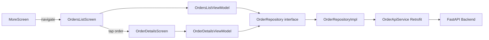

# Order Management Feature — Implementation Plan

## Phase 1 — Audit Complete

### Codebase Findings

| Question | Answer |
|---|---|
| Order Management screen exists? | **No** — zero order-related code |
| Order models or API services? | **No** — nothing to extend |
| Order repositories (fake or real)? | **No** — would need to be created |
| Order details and status history? | **No** — not supported |
| Backend API contracts? | **In task description** — all endpoints documented |
| Navigation structure? | 11 routes, 5 bottom nav tabs, More menu hub |
| DI structure? | Hilt with `@Module`/`@Binds`, follows Dashboard pattern |

### Architecture Pattern (from Dashboard vertical slice)

```
feature/dashboard/
├── domain/
│   └── DashboardRepository.kt      # Interface + domain models
├── data/
│   ├── FakeDashboardRepository.kt  # Development-only fake
│   └── DashboardModule.kt          # Hilt @Binds module
└── presentation/
    ├── DashboardViewModel.kt       # @HiltViewModel, StateFlow<DashboardUiState>
    └── DashboardScreen.kt          # Compose screen, ViewModel-driven
```

### Existing References
- `AuthApiService.kt` — Retrofit service pattern with request/response DTOs
- `NetworkModule.kt` — Hilt `@Module` providing Retrofit, OkHttp with auth interceptor
- `DashboardRepository.kt` — Domain models + repository interface pattern
- `DashboardViewModel.kt` — ViewModel with StateFlow, loading/error/retry states
- `MoreScreen.kt` — Menu hub for sub-destinations (will add Orders here)
- `Statuses.kt` — StatusPill, StatusType, ActivityStatus components
- `Cards.kt` — KpiCard, ActivityStreamCard components
- `Dialogs.kt` — ConfirmationDialog component
- `States.kt` — LoadingScreen, EmptyState, ErrorState components
- `Inputs.kt` — SearchBar, FilterChips components
- `Result.kt` — Sealed interface: Success/Error/Loading
- `AppError.kt` — Typed error categories
- `ApiErrorParser` — FastAPI error parsing with detail extraction

### API Contracts (from task description)

| Method | Endpoint | Description |
|---|---|---|
| GET | `/api/v1/orders/admin/orders` | List orders with pagination and filters |
| GET | `/api/v1/orders/{order_id}` | Order details |
| GET | `/api/v1/orders/{order_id}/status-history` | Status history timeline |
| POST | `/api/v1/orders/{order_id}/confirm` | Confirm pending order |
| POST | `/api/v1/orders/admin/{order_id}/reject` | Reject with reason |
| POST | `/api/v1/orders/{order_id}/process` | Process confirmed order |
| POST | `/api/v1/orders/{order_id}/dispatch` | Dispatch order |
| POST | `/api/v1/orders/{order_id}/deliver` | Deliver order |

### Navigation Placement
- Orders accessible from **More menu** (user confirmed)
- New routes: `OrdersRoute`, `OrderDetailsRoute`

---

## Requirements

### Overview
Implement a production-quality Order Management feature allowing administrators to view, inspect, filter, and manage customer orders through the FastAPI backend.

### Scope

**In Scope:**
- Orders list screen with pagination and filters (order status, fulfillment status)
- Order details screen with customer, delivery, and product information
- Order status history timeline
- Order lifecycle actions: confirm, reject, process, dispatch, deliver
- Rejection dialog with mandatory reason
- Confirmation dialogs for destructive actions
- Loading, empty, error, and retry states
- Navigation integration via More menu

**Out of Scope:**
- Delivery OTP or customer delivery confirmation codes
- Separate delivery-person application
- Payment collection workflows
- Payment gateway integration
- Customer profile expansion
- Inventory management changes
- Backend endpoint changes

### Functional Requirements
1. Display paginated orders with pull-to-refresh
2. Filter by order status (Pending, Completed, Cancelled, Rejected) and fulfillment status (Awaiting Confirmation, Confirmed, Processing, Out for Delivery, Delivered)
3. View order details including products, delivery info, and status
4. View chronological status history timeline distinguishing order vs fulfillment changes
5. Execute lifecycle actions with confirmation dialogs
6. Reject orders with mandatory reason
7. Prevent duplicate submissions
8. Refresh order details after successful actions
9. Display meaningful backend error messages

---

## Technical Design

### Current Implementation
The project follows Clean Architecture with MVVM. Each feature has domain (repository interface + models), data (repository impl + API service), and presentation (ViewModel + screen) layers. Hilt provides DI. Retrofit/OkHttp handles networking with auth interceptor. The design system provides reusable components (StatusPill, ConfirmationDialog, LoadingScreen, EmptyState, ErrorState, FilterChips).

### Key Decisions
1. **Two separate status enums** — `OrderStatus` and `FulfillmentStatus` as separate Kotlin enums, not combined, matching the backend's two-field model
2. **Real API integration** — no fake repository for production; the repository implementation calls the real backend directly
3. **Pagination with LazyColumn** — load more items when user reaches end of list, prevent duplicate requests
4. **Action eligibility in UI** — determine which actions are available based on current order status and fulfillment status, but treat backend as authoritative
5. **Safe enum parsing** — handle unknown backend enum values so new statuses don't crash the app
6. **Monetary values as Double** — backend serializes as JSON floats; display as-is without domain arithmetic

### Proposed Changes

#### New Feature Package: `feature/orders`

```
feature/orders/
├── domain/
│   ├── OrderRepository.kt          # Repository interface + domain models
│   └── OrderStatus.kt              # OrderStatus and FulfillmentStatus enums
├── data/
│   ├── OrderApiService.kt          # Retrofit service interface + DTOs
│   ├── OrderMapper.kt              # DTO-to-domain mappers
│   └── OrderModule.kt              # Hilt module providing OrderApiService
└── presentation/
    ├── OrdersListViewModel.kt      # ViewModel for orders list
    ├── OrdersListScreen.kt         # Orders list with filters and pagination
    ├── OrderDetailsViewModel.kt    # ViewModel for order details + actions
    ├── OrderDetailsScreen.kt       # Order details with status history
    └── OrderComponents.kt          # Order-specific UI components
```

#### Modified Files
- `AppDestination.kt` — add `OrdersRoute` and `OrderDetailsRoute`
- `AppNavHost.kt` — register order routes
- `MoreScreen.kt` — add "Orders" menu item

### Data Models / Contracts

#### Domain Models

```kotlin
// OrderStatus.kt
enum class OrderStatus {
    PENDING, COMPLETED, CANCELLED, REJECTED;
    companion object {
        fun fromString(value: String): OrderStatus =
            values().find { it.name == value.uppercase() } ?: PENDING
    }
}

enum class FulfillmentStatus {
    AWAITING_CONFIRMATION, CONFIRMED, PROCESSING, OUT_FOR_DELIVERY, DELIVERED;
    companion object {
        fun fromString(value: String): FulfillmentStatus =
            values().find { it.name == value.uppercase() } ?: AWAITING_CONFIRMATION
    }
}

// OrderRepository.kt
data class OrderItem(
    val productId: String,
    val productName: String,
    val quantity: Int,
    val price: Double,
    val lineTotal: Double?
)

data class OrderSummary(
    val id: String,
    val createdAt: String,
    val status: OrderStatus,
    val fulfillmentStatus: FulfillmentStatus,
    val totalAmount: Double,
    val currency: String,
    val recipientName: String?,
    val recipientPhone: String?
)

data class OrderDetails(
    val id: String,
    val createdAt: String,
    val status: OrderStatus,
    val fulfillmentStatus: FulfillmentStatus,
    val items: List<OrderItem>,
    val subtotal: Double,
    val totalAmount: Double,
    val currency: String,
    val recipientName: String?,
    val recipientPhone: String?,
    val deliveryAddress: String?,
    val buildingNumber: String?,
    val apartment: String?,
    val deliveryInstructions: String?
)

data class StatusHistoryEntry(
    val previousStatus: String?,
    val newStatus: String,
    val statusType: String, // "order" or "fulfillment"
    val actorRole: String?,
    val reason: String?,
    val timestamp: String
)

data class PaginatedOrders(
    val orders: List<OrderSummary>,
    val page: Int,
    val size: Int,
    val totalPages: Int,
    val totalItems: Int
)

interface OrderRepository {
    suspend fun listOrders(
        page: Int,
        size: Int,
        status: OrderStatus?,
        fulfillmentStatus: FulfillmentStatus?
    ): Result<PaginatedOrders>
    suspend fun getOrderDetails(orderId: String): Result<OrderDetails>
    suspend fun getStatusHistory(orderId: String): Result<List<StatusHistoryEntry>>
    suspend fun confirmOrder(orderId: String): Result<Unit>
    suspend fun rejectOrder(orderId: String, reason: String): Result<Unit>
    suspend fun processOrder(orderId: String): Result<Unit>
    suspend fun dispatchOrder(orderId: String): Result<Unit>
    suspend fun deliverOrder(orderId: String): Result<Unit>
}
```

#### API DTOs (OrderApiService.kt)

```kotlin
interface OrderApiService {
    @GET("api/v1/orders/admin/orders")
    suspend fun listOrders(
        @Query("page") page: Int,
        @Query("size") size: Int,
        @Query("status") status: String?,
        @Query("fulfillment_status") fulfillmentStatus: String?
    ): OrdersListResponse

    @GET("api/v1/orders/{order_id}")
    suspend fun getOrderDetails(@Path("order_id") orderId: String): OrderDetailsResponse

    @GET("api/v1/orders/{order_id}/status-history")
    suspend fun getStatusHistory(@Path("order_id") orderId: String): StatusHistoryResponse

    @POST("api/v1/orders/{order_id}/confirm")
    suspend fun confirmOrder(@Path("order_id") orderId: String)

    @POST("api/v1/orders/admin/{order_id}/reject")
    suspend fun rejectOrder(@Path("order_id") orderId: String, @Body request: RejectRequest)

    @POST("api/v1/orders/{order_id}/process")
    suspend fun processOrder(@Path("order_id") orderId: String)

    @POST("api/v1/orders/{order_id}/dispatch")
    suspend fun dispatchOrder(@Path("order_id") orderId: String)

    @POST("api/v1/orders/{order_id}/deliver")
    suspend fun deliverOrder(@Path("order_id") orderId: String)
}

data class RejectRequest(val reason: String)
```

### Components

#### OrdersListScreen
- Top app bar with "Orders" title
- Filter chips for order status and fulfillment status
- Pull-to-refresh
- LazyColumn with OrderSummary cards
- Load more on scroll (pagination)
- Loading, empty, error states
- Tap to navigate to OrderDetails

#### OrderDetailsScreen
- Order info header (ID, date, status pills)
- Customer/delivery section
- Order items list with quantities and prices
- Payment summary (subtotal, total, currency)
- Status history timeline
- Action buttons based on current status
- Rejection dialog with text input
- Confirmation dialogs for other actions

#### OrderComponents.kt
- `OrderSummaryCard` — compact card for list items
- `StatusTimelineItem` — timeline entry with order/fulfillment distinction
- `OrderActionButtons` — action buttons with loading states

### Architecture Diagram



### Risks
1. **Backend contract gaps** — the task describes endpoints but not exact response JSON shapes. I'll define reasonable DTOs based on the task description and mark for backend confirmation.
2. **Pagination response structure** — the backend's pagination wrapper format is not explicitly documented. I'll assume a standard structure with `items`, `page`, `size`, `total_pages`, `total_items` fields.
3. **Order details response** — the task lists fields to display but doesn't specify the exact JSON structure. I'll define DTOs matching the described fields.

---

## Testing

### Validation Approach
Unit tests for ViewModels using MockK for repository mocking and Turbine for StateFlow testing. Data layer tests for DTO deserialization and enum mapping.

### Key Scenarios
- Orders list: initial loading, success, empty, error, pagination, filtering
- Order details: loading, success, error, nullable fields
- Status history: loading, success, empty, order vs fulfillment distinction
- Actions: confirm success/failure, reject with reason, empty reason validation, duplicate prevention
- UI: action visibility based on status, loading states, error states

### Test Files
- `OrdersListViewModelTest.kt` — list loading, pagination, filtering, error handling
- `OrderDetailsViewModelTest.kt` — details loading, actions, rejection, duplicate prevention
- `OrderMapperTest.kt` — DTO-to-domain mapping, enum parsing, unknown enum handling, nullable fields

---

## Delivery Steps

### * Step 1: Domain and Data layer — models, API service, repository, and mappers
Create the order domain models, status enums, Retrofit API service, DTO-to-domain mappers, and repository implementation.

- Create `OrderStatus.kt` with `OrderStatus` and `FulfillmentStatus` enums with safe `fromString` parsing
- Create `OrderRepository.kt` with domain models (`OrderSummary`, `OrderDetails`, `StatusHistoryEntry`, `PaginatedOrders`, `OrderItem`) and repository interface
- Create `OrderApiService.kt` with Retrofit endpoints and request/response DTOs
- Create `OrderMapper.kt` with DTO-to-domain mapping functions
- Create `OrderModule.kt` with Hilt `@Provides` for `OrderApiService`
- Create `OrderRepositoryImpl.kt` implementing `OrderRepository` with real API calls and error handling
- Add `OrderMapperTest.kt` with tests for enum mapping, unknown enum handling, and nullable fields

### Stage 2: Orders List — ViewModel, screen, filters, and pagination
Implement the orders list screen with pull-to-refresh, filters, and pagination.

- Create `OrdersListViewModel.kt` with `StateFlow<OrdersListUiState>`, pagination logic, filter state, and pull-to-refresh
- Create `OrdersListScreen.kt` with top app bar, filter chips, LazyColumn, pull-to-refresh, and loading/empty/error states
- Create `OrderComponents.kt` with `OrderSummaryCard` composable
- Add `OrdersRoute` to `AppDestination.kt`
- Register `OrdersRoute` in `AppNavHost.kt`
- Add "Orders" menu item to `MoreScreen.kt`
- Add `OrdersListViewModelTest.kt` with tests for loading, pagination, filtering, and error handling

### Stage 3: Order Details — ViewModel, screen, status history, and lifecycle actions
Implement order details screen with status history timeline and all lifecycle actions.

- Create `OrderDetailsViewModel.kt` with `StateFlow<OrderDetailsUiState>`, action methods, rejection reason handling, and duplicate prevention
- Create `OrderDetailsScreen.kt` with order info, customer/delivery section, items list, payment summary, status history timeline, and action buttons
- Add `StatusTimelineItem` composable to `OrderComponents.kt`
- Add `OrderDetailsRoute` to `AppDestination.kt` with orderId parameter
- Register `OrderDetailsRoute` in `AppNavHost.kt`
- Add `OrderDetailsViewModelTest.kt` with tests for details loading, actions, rejection, and duplicate prevention
- Verify build compiles and all tests pass