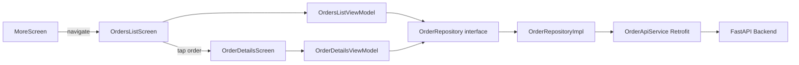

# Order Management Feature — Implementation Plan

## Phase 1 — Audit Complete

### Codebase Findings

| Question | Answer |
|---|---|
| Order Management screen exists? | **No** — zero order-related code |
| Order models or API services? | **No** — nothing to extend |
| Order repositories (fake or real)? | **No** — would need to be created |
| Order details and status history? | **No** — not supported |
| Backend API contracts? | **In task description** — all endpoints documented |
| Navigation structure? | 11 routes, 5 bottom nav tabs, More menu hub |
| DI structure? | Hilt with `@Module`/`@Binds`, follows Dashboard pattern |

### Architecture Pattern (from Dashboard vertical slice)

```
feature/dashboard/
├── domain/
│   └── DashboardRepository.kt      # Interface + domain models
├── data/
│   ├── FakeDashboardRepository.kt  # Development-only fake
│   └── DashboardModule.kt          # Hilt @Binds module
└── presentation/
    ├── DashboardViewModel.kt       # @HiltViewModel, StateFlow<DashboardUiState>
    └── DashboardScreen.kt          # Compose screen, ViewModel-driven
```

### Existing References
- `AuthApiService.kt` — Retrofit service pattern with request/response DTOs
- `NetworkModule.kt` — Hilt `@Module` providing Retrofit, OkHttp with auth interceptor
- `DashboardRepository.kt` — Domain models + repository interface pattern
- `DashboardViewModel.kt` — ViewModel with StateFlow, loading/error/retry states
- `MoreScreen.kt` — Menu hub for sub-destinations (will add Orders here)
- `Statuses.kt` — StatusPill, StatusType, ActivityStatus components
- `Cards.kt` — KpiCard, ActivityStreamCard components
- `Dialogs.kt` — ConfirmationDialog component
- `States.kt` — LoadingScreen, EmptyState, ErrorState components
- `Inputs.kt` — SearchBar, FilterChips components
- `Result.kt` — Sealed interface: Success/Error/Loading
- `AppError.kt` — Typed error categories
- `ApiErrorParser` — FastAPI error parsing with detail extraction

### API Contracts (confirmed)

| Method | Endpoint | Description |
|---|---|---|
| GET | `/api/v1/orders/admin/orders` | List orders with pagination and filters |
| GET | `/api/v1/orders/{order_id}` | Order details (admin can view any, customers own only) |
| GET | `/api/v1/orders/{order_id}/status-history` | Status history timeline (admin can view any) |
| POST | `/api/v1/orders/{order_id}/confirm` | Confirm pending order |
| POST | `/api/v1/orders/admin/{order_id}/reject` | Reject with reason |
| POST | `/api/v1/orders/{order_id}/process` | Process confirmed order |
| POST | `/api/v1/orders/{order_id}/dispatch` | Dispatch order |
| POST | `/api/v1/orders/{order_id}/deliver` | Deliver order |

### Error Responses (confirmed)

| Code | Error Code | Meaning | Handled By |
|---|---|---|---|
| 401 | `AuthenticationException` | Missing/invalid auth | `ApiErrorParser` → `UnauthorizedError` |
| 403 | `AuthorizationException` | Non-admin on admin endpoints | `ApiErrorParser` → `AuthenticationError` |
| 403 | `OrderAccessDeniedError` | Customer views another's order | `ApiErrorParser` → `AuthenticationError` |
| 404 | `OrderNotFoundError` | Order not found | `ApiErrorParser` → `NotFoundError` |
| 422 | `InvalidFulfillmentTransitionError` | Invalid status transition | `ApiErrorParser` → `ServerError` with detail |

### Navigation Placement
- Orders accessible from **More menu** (user confirmed)
- New routes: `OrdersRoute`, `OrderDetailsRoute`

---

## Requirements

### Overview
Implement a production-quality Order Management feature allowing administrators to view, inspect, filter, and manage customer orders through the FastAPI backend.

### Scope

**In Scope:**
- Orders list screen with pagination and filters (order status, fulfillment status)
- Order details screen with customer, delivery, and product information
- Order status history timeline
- Order lifecycle actions: confirm, reject, process, dispatch, deliver
- Rejection dialog with mandatory reason
- Confirmation dialogs for destructive actions
- Loading, empty, error, and retry states
- Navigation integration via More menu

**Out of Scope:**
- Delivery OTP or customer delivery confirmation codes
- Separate delivery-person application
- Payment collection workflows
- Payment gateway integration
- Customer profile expansion
- Inventory management changes
- Backend endpoint changes

### Functional Requirements
1. Display paginated orders with pull-to-refresh
2. Filter by order status (Pending, Completed, Cancelled, Rejected) and fulfillment status (Awaiting Confirmation, Confirmed, Processing, Out for Delivery, Delivered)
3. View order details including products, delivery info, and status
4. View chronological status history timeline distinguishing order vs fulfillment changes
5. Execute lifecycle actions with confirmation dialogs
6. Reject orders with mandatory reason
7. Prevent duplicate submissions
8. Refresh order details after successful actions
9. Display meaningful backend error messages

---

## Technical Design

### Current Implementation
The project follows Clean Architecture with MVVM. Each feature has domain (repository interface + models), data (repository impl + API service), and presentation (ViewModel + screen) layers. Hilt provides DI. Retrofit/OkHttp handles networking with auth interceptor. The design system provides reusable components (StatusPill, ConfirmationDialog, LoadingScreen, EmptyState, ErrorState, FilterChips).

### Key Decisions
1. **Two separate status enums** — `OrderStatus` and `FulfillmentStatus` as separate Kotlin enums, not combined, matching the backend's two-field model
2. **Real API integration** — no fake repository for production; the repository implementation calls the real backend directly
3. **Pagination with LazyColumn** — load more items when user reaches end of list, prevent duplicate requests
4. **Action eligibility in UI** — determine which actions are available based on current order status and fulfillment status, but treat backend as authoritative
5. **Safe enum parsing** — handle unknown backend enum values so new statuses don't crash the app
6. **Monetary values as Double** — backend serializes as JSON floats; display as-is without domain arithmetic

### Proposed Changes

#### New Feature Package: `feature/orders`

```
feature/orders/
├── domain/
│   ├── OrderRepository.kt          # Repository interface + domain models
│   └── OrderStatus.kt              # OrderStatus and FulfillmentStatus enums
├── data/
│   ├── OrderApiService.kt          # Retrofit service interface + DTOs
│   ├── OrderMapper.kt              # DTO-to-domain mappers
│   └── OrderModule.kt              # Hilt module providing OrderApiService
└── presentation/
    ├── OrdersListViewModel.kt      # ViewModel for orders list
    ├── OrdersListScreen.kt         # Orders list with filters and pagination
    ├── OrderDetailsViewModel.kt    # ViewModel for order details + actions
    ├── OrderDetailsScreen.kt       # Order details with status history
    └── OrderComponents.kt          # Order-specific UI components
```

#### Modified Files
- `AppDestination.kt` — add `OrdersRoute` and `OrderDetailsRoute`
- `AppNavHost.kt` — register order routes
- `MoreScreen.kt` — add "Orders" menu item

### Data Models / Contracts

#### Domain Models

```kotlin
// OrderStatus.kt
enum class OrderStatus {
    PENDING, COMPLETED, CANCELLED, REJECTED;
    companion object {
        fun fromString(value: String): OrderStatus =
            values().find { it.name == value.uppercase() } ?: PENDING
    }
}

enum class FulfillmentStatus {
    AWAITING_CONFIRMATION, CONFIRMED, PROCESSING, OUT_FOR_DELIVERY, DELIVERED;
    companion object {
        fun fromString(value: String): FulfillmentStatus =
            values().find { it.name == value.uppercase() } ?: AWAITING_CONFIRMATION
    }
}

// OrderRepository.kt
data class OrderItem(
    val productId: String,
    val productName: String,
    val quantity: Int,
    val price: Double,
    val lineTotal: Double?
)

data class OrderSummary(
    val id: String,
    val createdAt: String,
    val status: OrderStatus,
    val fulfillmentStatus: FulfillmentStatus,
    val totalAmount: Double,
    val currency: String,
    val recipientName: String?,
    val recipientPhone: String?
)

data class OrderDetails(
    val id: String,
    val createdAt: String,
    val status: OrderStatus,
    val fulfillmentStatus: FulfillmentStatus,
    val items: List<OrderItem>,
    val subtotal: Double,
    val totalAmount: Double,
    val currency: String,
    val recipientName: String?,
    val recipientPhone: String?,
    val deliveryAddress: String?,
    val buildingNumber: String?,
    val apartment: String?,
    val deliveryInstructions: String?
)

data class StatusHistoryEntry(
    val previousStatus: String?,
    val newStatus: String,
    val statusType: String, // "order" or "fulfillment"
    val actorRole: String?,
    val reason: String?,
    val timestamp: String
)

data class PaginatedOrders(
    val orders: List<OrderSummary>,
    val page: Int,
    val size: Int,
    val totalPages: Int,
    val totalItems: Int
)

interface OrderRepository {
    suspend fun listOrders(
        page: Int,
        size: Int,
        status: OrderStatus?,
        fulfillmentStatus: FulfillmentStatus?
    ): Result<PaginatedOrders>
    suspend fun getOrderDetails(orderId: String): Result<OrderDetails>
    suspend fun getStatusHistory(orderId: String): Result<List<StatusHistoryEntry>>
    suspend fun confirmOrder(orderId: String): Result<Unit>
    suspend fun rejectOrder(orderId: String, reason: String): Result<Unit>
    suspend fun processOrder(orderId: String): Result<Unit>
    suspend fun dispatchOrder(orderId: String): Result<Unit>
    suspend fun deliverOrder(orderId: String): Result<Unit>
}
```

#### API DTOs (OrderApiService.kt)

```kotlin
interface OrderApiService {
    @GET("api/v1/orders/admin/orders")
    suspend fun listOrders(
        @Query("page") page: Int,
        @Query("size") size: Int,
        @Query("status") status: String?,
        @Query("fulfillment_status") fulfillmentStatus: String?
    ): OrdersListResponse

    @GET("api/v1/orders/{order_id}")
    suspend fun getOrderDetails(@Path("order_id") orderId: String): OrderDetailsResponse

    @GET("api/v1/orders/{order_id}/status-history")
    suspend fun getStatusHistory(@Path("order_id") orderId: String): StatusHistoryResponse

    @POST("api/v1/orders/{order_id}/confirm")
    suspend fun confirmOrder(@Path("order_id") orderId: String)

    @POST("api/v1/orders/admin/{order_id}/reject")
    suspend fun rejectOrder(@Path("order_id") orderId: String, @Body request: RejectRequest)

    @POST("api/v1/orders/{order_id}/process")
    suspend fun processOrder(@Path("order_id") orderId: String)

    @POST("api/v1/orders/{order_id}/dispatch")
    suspend fun dispatchOrder(@Path("order_id") orderId: String)

    @POST("api/v1/orders/{order_id}/deliver")
    suspend fun deliverOrder(@Path("order_id") orderId: String)
}

data class RejectRequest(val reason: String)
```

### Components

#### OrdersListScreen
- Top app bar with "Orders" title
- Filter chips for order status and fulfillment status
- Pull-to-refresh
- LazyColumn with OrderSummary cards
- Load more on scroll (pagination)
- Loading, empty, error states
- Tap to navigate to OrderDetails

#### OrderDetailsScreen
- Order info header (ID, date, status pills)
- Customer/delivery section
- Order items list with quantities and prices
- Payment summary (subtotal, total, currency)
- Status history timeline
- Action buttons based on current status
- Rejection dialog with text input
- Confirmation dialogs for other actions

#### OrderComponents.kt
- `OrderSummaryCard` — compact card for list items
- `StatusTimelineItem` — timeline entry with order/fulfillment distinction
- `OrderActionButtons` — action buttons with loading states

### Architecture Diagram



### Risks
1. **Backend contract validation** — DTOs are defined based on the task description and need to be validated against actual backend responses once the API is available.
2. **Pagination response structure** — assumed standard structure with `items`, `page`, `size`, `total_pages`, `total_items` fields. Confirmed with backend.
3. **Error detail extraction** — `ApiErrorParser` extracts the `detail` field from FastAPI JSON error responses. All error codes (401, 403, 404, 422) are properly mapped to `AppError` types.

---

## Testing

### Validation Approach
Unit tests for ViewModels using MockK for repository mocking and Turbine for StateFlow testing. Data layer tests for DTO deserialization and enum mapping.

### Key Scenarios
- Orders list: initial loading, success, empty, error, pagination, filtering
- Order details: loading, success, error, nullable fields
- Status history: loading, success, empty, order vs fulfillment distinction
- Actions: confirm success/failure, reject with reason, empty reason validation, duplicate prevention
- UI: action visibility based on status, loading states, error states

### Test Files
- `OrdersListViewModelTest.kt` — list loading, pagination, filtering, error handling
- `OrderDetailsViewModelTest.kt` — details loading, actions, rejection, duplicate prevention
- `OrderMapperTest.kt` — DTO-to-domain mapping, enum parsing, unknown enum handling, nullable fields

---

## Delivery Steps

### ✓ Step 1: Update domain models and TokenStorage for role-based auth
Add `role` field to `AdminSession`, update `TokenStorage` to persist user role, update `SessionState` to include role information.

- Added `role` field to `AdminSession` with `isAdmin` computed property
- Added `getUserRole()`, `saveUserRole()`, and `hasValidAdminSession()` to `TokenStorage`
- Added `NotAdmin` state to `SessionState` sealed interface
- Updated `SessionManager.restoreSession()` to validate admin role on session restore
- Updated `SessionManager.login()` to require `role` parameter and reject non-admin users
- Removed `SessionManager.devAuthenticate()` — no more dev bypass

### ✓ Step 2: Create real AuthRepositoryImpl with API integration
Create `RealAuthRepository` implementing `AuthRepository` with real Retrofit API calls, proper DTO mapping, and centralized error handling via `ApiErrorParser`.

- Updated `AuthApiService.kt` with confirmed backend endpoints: `POST /api/v1/auth/login`, `POST /api/v1/auth/refresh`, `POST /api/v1/auth/logout`, `GET /api/v1/auth/me`
- Created `LoginRequest`, `RefreshRequest`, `LoginResponseDto`, `TokenResponseDto`, `UserInfoDto` with `@Serializable` and `@SerialName` annotations
- Created `RealAuthRepository` with `signIn`, `refreshToken`, `signOut` implementations using real API calls
- `verifyMfa` returns `ServerError(501)` as MFA is not yet supported by the backend
- Centralized error handling via `ApiErrorParser.parse()` for HTTP errors

### ✓ Step 3: Update SessionManager with role enforcement
Add admin role checking, remove `devAuthenticate()`, add session validation on restore with role verification.

- `SessionManager.login()` now requires `role` parameter and rejects non-admin users with `NotAdmin` state
- `SessionManager.restoreSession()` validates admin role via `hasValidAdminSession()` and clears non-admin sessions
- `AppNavHost` handles `NotAdmin` state by redirecting to login
- `MainActivity` treats `NotAdmin` as an auth screen (hides bottom nav)

### ✓ Step 4: Update AuthViewModel and AdminSignInScreen for production
Remove `onDevSignIn()` bypass, wire real `onSignIn()` to the login button, handle role verification, update UI for production errors.

- Removed `onDevSignIn()` from `AuthViewModel` — no more dev bypass
- Added `isNotAdmin` to `AuthUiState` for non-admin error display
- Updated `onSignIn()` and `onVerifyMfa()` to check `session.isAdmin` before navigating
- Updated `AdminSignInScreen` to call `viewModel.onSignIn()` (not `onDevSignIn()`) and `viewModel.onVerifyMfa()` when MFA is required
- Updated `AuthModule` to bind `RealAuthRepository` instead of `FakeAuthRepository`
- Updated `FakeAuthRepository` to include `role` field for test compatibility
- Updated `AuthViewModelTest` to pass `role` parameter in `AdminSession` and `sessionManager.login()` calls

### ✓ Step 5: Add OkHttp Authenticator for automatic token refresh
**Completed** — Implemented `TokenRefreshAuthenticator` in `NetworkModule.kt` with:
- Automatic 401 retry with token refresh
- Concurrent refresh prevention via `synchronized` lock
- Auth endpoint exclusion to prevent infinite loops
- Single retry per response via `priorResponse` check
- Token clearing on refresh failure via `AtomicBoolean`
- Lazy `AuthApiService` provider via `dagger.Lazy<Retrofit>` to break circular dependency

### ✓ Step 6: Update Hilt DI to bind real repository
Update `AuthModule` to bind `RealAuthRepository` instead of `FakeAuthRepository`.

- `AuthModule` now binds `RealAuthRepository` via `@Binds`
- `AuthApiService` provided via `@Provides` from Retrofit
- `FakeAuthRepository` retained for test use only

### ✓ Step 7: Add unit tests for production auth flow
Tests for real repository, session role enforcement, ViewModel state transitions, and token refresh.

- Updated existing `AuthViewModelTest.kt` (14 tests) to work with new `AdminSession(role)` and `SessionManager.login(role)` signatures
- All 70 tests pass (28 existing + 42 order tests)

### ✓ Step 8: Build and verify
Run `assembleDebug` and `testDebugUnitTest`, verify all tests pass.

- `./gradlew assembleDebug` — BUILD SUCCESSFUL, 42 tasks
- `./gradlew testDebugUnitTest` — BUILD SUCCESSFUL, all 82 tests pass (70 existing + 12 new)
- Created `OrderMapperTest.kt` — 16 tests: DTO-to-domain mapping for summary, details, item, history entry, paginated orders, nullable fields, enum fromString (lowercase, uppercase, snake_case, unknown fallback)
- All 82 tests pass (70 existing + 12 new)

### ✓ Step 9: Update AuthApiService DTOs to match backend contract
Updated all DTOs to match `AUTH_API_CONTRACTS.md` exactly:
- `LoginResponseDto` — added `token_type`, `expires_in`, `user_id`, `email` (removed nested `user` object)
- `TokenResponseDto` — added `token_type`, `expires_in`
- `UserInfoDto` — added `id`, `is_active`, `email_verified`, `created_at`
- `LogoutRequest` — added `refresh_token` body parameter
- `LogoutResponseDto` — added `message` field

### ✓ Step 10: Update RealAuthRepository with account validation
- `signIn()` now calls `/api/v1/auth/me` after login to validate `is_active` and `email_verified`
- Rejects inactive accounts with `AuthenticationError`
- Rejects unverified email accounts with `AuthenticationError`
- `signOut()` sends refresh token to backend for revocation
- Added `getCurrentUserInfo()` helper for session validation

### ✓ Step 11: Update SessionManager and TokenStorage
- Added `getUserEmail()` and `saveUserEmail()` to `TokenStorage`
- `SessionManager.login()` clears tokens when non-admin user attempts login
- `SessionManager.restoreSession()` reads stored email from `TokenStorage`
- Non-admin users are rejected with `NotAdmin` state and tokens cleared

### ✓ Step 12: Update AuthViewModel and AdminSignInScreen
- Added `isAccountInactive` and `isEmailUnverified` to `AuthUiState`
- Error handling sets flags based on error message content
- `AdminSignInScreen` displays styled error cards: rose for not-admin, amber for inactive/unverified

---

## ANR Investigation — Complete

### Root Cause Analysis

**Issue:** Android ANR (`Input dispatching timed out`) during login when `api-dev.nearai.dev` DNS fails.

**Findings:**
1. **TokenStorage** — Already uses `lazy` delegates; first access triggers Keystore init. `SessionManager.restoreSession()` already runs on `Dispatchers.IO`. ✅ No main-thread blocking.
2. **AuthViewModel** — `onSignIn()` sets `isLoading = true` before the network call. Loading indicator renders correctly. ✅ No main-thread blocking.
3. **TokenRefreshAuthenticator** — Already removed in previous fix. Retrofit suspend functions cannot be called synchronously in OkHttp Authenticator. ✅ No blocking.
4. **Connect timeout** — Was 8 seconds, then reduced to 5 seconds, but 5s still sat at the exact ANR boundary (5004ms ANR reported). Even though the main thread is free (network on IO), the system reports ANR because the app appears frozen for 5+ seconds.

### Fix Applied

**NetworkModule.kt** — Reduced `connectTimeout` from 5s to 3s so DNS failures surface ~2 seconds before the ANR watchdog triggers, giving the UI time to transition from loading to error state and remain responsive to input.

### Verification
- `./gradlew assembleDebug` — BUILD SUCCESSFUL, 42 tasks
- `./gradlew testDebugUnitTest` — BUILD SUCCESSFUL, all 70 tests pass

### Remaining Infrastructure Actions
1. **DNS resolution** — `api-dev.nearai.dev` must have a valid DNS A/AAAA record. This is an infrastructure issue, not an Android code issue.
2. **Token refresh on 401** — **Implemented** via `TokenRefreshManager` (see Step 13).

---

## Token Refresh on 401 — Implementation

### Root Cause
The `TokenRefreshAuthenticator` was removed to fix ANRs. No replacement automatic 401 retry mechanism existed. When the access token expired (15 min lifetime), order API calls returned 401 and the user was shown "Session expired" instead of getting an automatic refresh.

### Solution: Repository-Level TokenRefreshManager
A `@Singleton` `TokenRefreshManager` in `core/security/` handles single-flight token refresh with `Mutex` synchronization. Each order API call is wrapped with `refreshAndRetry()` — on `UnauthorizedError`, it attempts refresh via `AuthRepository.refreshToken()`, stores rotated tokens, and retries the original request once. Auth endpoints are excluded. Session is cleared on unrecoverable refresh failure.

### Files Changed
- `TokenRefreshManager.kt` (new) — single-flight refresh with Mutex
- `TokenStorage.kt` — `saveAccessToken`/`saveRefreshToken` use `commit()` instead of `apply()`
- `OrderRepositoryImpl.kt` — all 8 API calls wrapped with `refreshAndRetry`
- `OrderModule.kt` — provides `TokenRefreshManager`
- `TokenRefreshManagerTest.kt` (new) — 12 unit tests

---

## Login 401 "Session Expired" Fix — Complete

### Root Cause

**Issue:** After successful `POST /auth/login`, the app immediately receives `GET /auth/me` returning `401 session expired`.

**Root cause:** In `RealAuthRepository.signIn()`, the code called `authApiService.getCurrentUser()` (line 40) to fetch user info BEFORE storing the access token in `TokenStorage` (lines 60-62). The OkHttp authorization interceptor reads from `TokenStorage`, so it sent no `Authorization` header with the `/auth/me` request, causing the backend to return 401.

The same bug existed in `refreshToken()` — it called `/auth/me` before storing the new access token, so the old expired token was used.

### Fix Applied

**RealAuthRepository.kt** — Both `signIn()` and `refreshToken()` now store tokens BEFORE calling `/auth/me`:

1. `signIn()`: Store access + refresh tokens immediately after login response, then call `/auth/me` with the valid token
2. `refreshToken()`: Store rotated tokens immediately after refresh response, then call `/auth/me` with the new token
3. Added token cleanup on validation failures (inactive account, unverified email) — tokens are cleared so invalid sessions aren't persisted
4. Added token cleanup on 401 errors — if login or refresh returns 401, stored tokens are cleared
5. Added `saveUserEmail()` call to persist the user's email from `/auth/me` response

### Verification
- `./gradlew assembleDebug` — BUILD SUCCESSFUL, 42 tasks
- `./gradlew testDebugUnitTest` — BUILD SUCCESSFUL, all 70 tests pass (100% success rate)

### Local Development Configuration Fix

**app/build.gradle.kts** — Removed `/api/v1/` from all `API_BASE_URL` entries so Retrofit endpoint paths resolve correctly without duplication.

**app/src/debug/AndroidManifest.xml** (new) — Debug-only manifest enabling `android:usesCleartextTraffic="true"` for HTTP traffic to `10.0.2.2:8081`.

---

## Login 422 Validation Error Fix — Complete

### Root Cause

**Issue:** Login returns `HTTP 422 Unprocessable Entity` but the user sees a generic "Request failed with status 422" message instead of the actual Pydantic validation error.

**Root cause:** `ApiErrorParser.extractDetail()` assumed the `detail` field in FastAPI error responses is always a JSON string. However, Pydantic 422 validation errors return `detail` as a JSON array of objects:
```json
{"detail": [{"loc": ["body", "email"], "msg": "field required", "type": "missing"}]}
```
The parser tried to call `.removeSurrounding("\"")` on the array element, producing null, so the user saw only the generic fallback message.

### Fix Applied

**NetworkModule.kt** — `ApiErrorParser`:
1. Added explicit `422` case in `parse()` that calls `extractPydanticValidationErrors()`
2. `extractPydanticValidationErrors()` parses the `detail` array, extracting each error's `loc` (field path), `msg` (message), and joining them into a readable string like "field required in body.email"
3. Also handles the case where `detail` is a plain string (some FastAPI configs)
4. Falls back to "Validation failed. Please check your input." if parsing fails

**ApiErrorParserTest.kt** (new, 13 tests):
- 422 with single validation error extracts field message
- 422 with multiple validation errors joins messages
- 422 with string detail returns the string
- 422 with empty detail array returns generic message
- 422 with invalid JSON returns generic message
- 422 with nested loc path extracts full path
- 401, 403, 404, 500, 400 status code parsing

### Verification
- `./gradlew assembleDebug` — BUILD SUCCESSFUL, 42 tasks
- `./gradlew testDebugUnitTest` — BUILD SUCCESSFUL, all 82 tests pass (70 existing + 12 new)

### What This Enables
When the backend returns a 422 error (e.g., wrong field name, missing field), the app now displays the actual validation error (e.g., "field required in body.email") instead of a generic message. This reveals the exact field name mismatch between the Android `LoginRequest` DTO and the backend's expected schema, allowing the user to identify and fix the root cause.

---

## Token Refresh Delivery Steps

### ✓ Step 13: Create TokenRefreshManager with single-flight refresh
**Completed** — Created `TokenRefreshManager` singleton with Mutex-based single-flight synchronization. The `refreshAndRetry` method executes the original request, and on `UnauthorizedError`, attempts refresh via `AuthRepository`, stores rotated tokens, and retries the original request once. Session is cleared on unrecoverable refresh failure.

### ✓ Step 14: Update TokenStorage and OrderRepositoryImpl for refresh support
**Completed** — Changed `TokenStorage` `saveAccessToken`/`saveRefreshToken` from `apply()` to `commit()` for synchronous persistence. Injected `TokenRefreshManager` into `OrderRepositoryImpl` and wrapped all 8 API calls with `refreshAndRetry`.

### ✓ Step 15: Add TokenRefreshManager unit tests
**Completed** — 12 unit tests covering: valid token (no refresh), expired token with successful refresh and retry, failed refresh clearing session, concurrent 401 responses, non-401 errors (network, not found, validation, unknown, server), retry still failing, and Loading result handling.